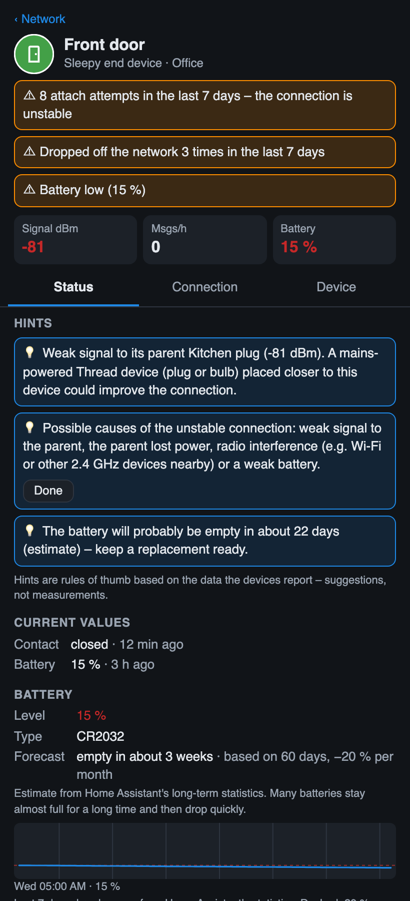

# Thread Pulse

**A live map of your Thread network for Home Assistant – watch your Matter devices talk.**

📖 **[User guide in the wiki](https://github.com/riticulus/ha-thread-pulse/wiki)** – installation, configuration, every feature explained, troubleshooting.


Thread Pulse draws the mesh of your Matter-over-Thread devices (routers, battery devices, border router, signal strength) and animates every message as it happens:

- **cyan dot** – a device reports something to Home Assistant (a sensor value, a button press, a light that was switched)
- **magenta dot** – Home Assistant sends a command to a device

Each dot travels the path the message most likely takes through the mesh: device → its parent router → … → border router. A small ticker shows the latest messages and how many arrived in the last minute.

It is a single HTML page that runs in your browser inside a Home Assistant dashboard. No integration, no add-on, no server component, no external requests.

## Features

- Interactive mesh map (drag, zoom), icons chosen from what each device does (light, plug, window, motion, button, thermostat …)
- Link colours by signal strength (RSSI): green ≥ −65 dBm, orange ≥ −80 dBm, red below
- Battery devices are linked to their parent router (dashed); their signal is taken from the router's measurement, which is more reliable than the device's own
- Live animation of messages to and from Home Assistant, with a ticker
- **Tap a device for details:** manufacturer, model, firmware, area, Thread role, parent and neighbours with signal strength, battery level and type, current values with “last changed”, stability counters (restarts, drop-offs, attach attempts, parent changes) and a button to open the device in Home Assistant
- **Border router panel:** tap the border router for the Thread network (name, channel, PAN ID, routers, leader) and the border router itself
- **Battery forecast:** estimate when a battery will be empty, from Home Assistant's long-term statistics
- **Matter on Wi-Fi / Ethernet:** shown as a separate group next to the mesh, with their own detail panel (Wi-Fi signal, channel)
- **Badges on the map:** battery level on battery devices, ⚠ on devices that look unstable or have a low battery
- **Traffic heat:** links glow the more messages travelled over them in the last 10 minutes, so the busy routes of the mesh stand out (estimate based on the computed paths); routers show how many messages they forwarded for others
- **Weak-spot hints:** rules of thumb for weak parent signals, unstable connections, routers that probably lose power regularly and routers at the edge of the mesh – suggestions, not measurements
- **Change log:** checks the network every 5 minutes and lists what changed (new parent, device offline / back, role, links), the device flashes on the map
- **Room view:** arrange the devices by Home Assistant area, with a coloured area per room – shows at a glance which links cross rooms
- **Double-click** on empty space to center and fit the whole mesh, on a device to zoom to it
- **Optional sound:** a quiet tick for every message, high for messages to Home Assistant, low for commands
- **Ambient mode** for wall tablets: only the pulsing mesh, dark, with a slow automatic zoom
- **Search:** find a device by name or area; matches are highlighted and zoomed to, Enter opens the details
- **Response time:** how long a device takes to confirm a command from Home Assistant – measured while the page is open
- **Live counter per device:** messages to and from Home Assistant since the page was opened (last minute, last hour, last message)
- Optional table: battery devices and their parents, weakest first, plus weak router-to-router links
- Follows the Home Assistant theme (light/dark); English, German, French, Italian, Spanish and Dutch (from your Home Assistant language)
- Does **not** wake up battery devices: it only reads data Home Assistant already has

### Detail view

Tap a device on the map to open its details (shown here from the demo mode with invented devices):



## Requirements

- Home Assistant with the **Matter** integration and Matter devices on **Thread**
- An **administrator** user (the page reads device diagnostics and the entity registry, which Home Assistant only allows for admins)
- Recommended: the **OpenThread Border Router** add-on. With other border routers (Apple, Google, Amazon …) the map still works; the live paths only work if Thread Pulse can tell which router is the border router (see limitations)

## Installation

There are three ways to use Thread Pulse. All of them show the same map.

### A) Dashboard card via HACS (recommended)

1. In Home Assistant open **HACS → ⋮ (top right) → Custom repositories**, enter `https://github.com/riticulus/ha-thread-pulse`, type **Dashboard**, and add it.
2. Search for **Thread Pulse** in HACS, open it and click **Download**. Reload the browser when HACS asks for it.
3. Edit a dashboard → **Add card** → **Thread Pulse** (or, in YAML, `type: custom:thread-pulse-card`).

HACS shows updates like for any other card. HACS installs from the latest *release*; the card is available from version 1.2.0.

**Card options** (all optional; also available in the visual card editor):

| Option | Default | Description |
|---|---|---|
| `height` | fills the available space (at least 450 px) | Any CSS height, e.g. `600px`, or `calc(100vh - 120px)` for a full-screen panel view |
| `language` | Home Assistant language | `en`, `de`, `fr`, `it`, `es` or `nl` |
| `show_wifi` | `true` | Show Matter devices on Wi-Fi / Ethernet as a separate group |
| `ambient` | `false` | Ambient mode for wall tablets: only the mesh, dark, slow automatic zoom |
| `ambient_motion` | `true` | In ambient mode: slow automatic zoom on (`true`) or off (`false`) |
| `demo` | `false` | Show invented devices instead of your network |

```yaml
type: custom:thread-pulse-card
height: calc(100vh - 120px)
```

In a *sections* view the card can be resized like other cards; in a *panel* view set `height` so it fills the screen.

### B) Dashboard card, manual installation

1. From the [latest release](https://github.com/riticulus/ha-thread-pulse/releases/latest) download **Source code (zip)**, unpack it and copy `dist/ha-thread-pulse.js` and `dist/thread-pulse-vis-network.js` into `/config/www/`.
2. *Settings → Dashboards → ⋮ → Resources → Add resource*: URL `/local/ha-thread-pulse.js`, type **JavaScript module**.
3. Add the card as in A). After an update, replace both files and reload the browser.

The graph library (`thread-pulse-vis-network.js`, ~1.6 MB) is only loaded when a Thread Pulse card is actually shown; other dashboards only load the small card file (~75 kB).

### C) Standalone page in an iframe

1. Open the [latest release](https://github.com/riticulus/ha-thread-pulse/releases/latest), download **Source code (zip)** and unpack it. You need `thread-pulse.html` and `thread-pulse-vis-network.js` from the top folder.
2. Copy both files into the `www` folder of your Home Assistant configuration (`/config/www/`, for example with the *File editor* or *Samba share* add-on). Create the folder if it does not exist – if you have to create it, restart Home Assistant once.
3. Add a card to a dashboard. Easiest is a full-page view (*panel* view) with an iframe card:

   ```yaml
   views:
     - title: Thread
       path: thread
       type: panel
       cards:
         - type: iframe
           url: /local/thread-pulse.html?v=1
           aspect_ratio: 100%
   ```

   Or, in the UI: *Edit dashboard → Add view → View type “Panel (single card)”*, then add a *Webpage* card with the URL `/local/thread-pulse.html?v=1`.

**Updating:** download the new release, replace both files and raise the number in `?v=1` (e.g. to `?v=2`) so browsers and the companion app load the new version. The installed version is shown at the end of the status line (e.g. `v1.0.0`). To get notified about new versions, use *Watch → Custom → Releases* on GitHub. Changes are listed in the [changelog](CHANGELOG.md).

> **Note:** this README describes the current development state. Features listed under *Unreleased* in the [changelog](CHANGELOG.md) are not part of a release yet – the [latest release](https://github.com/riticulus/ha-thread-pulse/releases/latest) does not contain them.

**Try it without Home Assistant:** open `thread-pulse.html?demo` in a browser (invented devices, simulated traffic). `&lang=de` switches to German.

## How it works

| What | Where it comes from |
|---|---|
| Devices, roles, neighbours, signal | Thread Network Diagnostics cluster of each Matter node, from Home Assistant's cached Matter diagnostics |
| Routes | Route tables of the routers (same source) |
| Border router | `otbr/info` of the OpenThread Border Router integration |
| Live messages | Home Assistant `state_changed` and `call_service` events of the Matter devices' entities |

## Limitations – please read

- **The animation shows messages to and from Home Assistant, not radio packets.** Thread's own background traffic (routers exchanging status every ~30 s, battery devices polling their parent, retransmissions) is not visible. Seeing real radio traffic needs a second 802.15.4 radio as a sniffer plus Wireshark and the network key.
- **The path is the most likely route, not a measured one.** It is computed from the route tables at the time the page was loaded. Thread can change routes at any time. Press *Reload* to refresh the map.
- **Only Matter devices.** Thread devices paired via HomeKit or other ecosystems only appear as “other Thread router” if they route, and their traffic is not shown.
- **Several border routers / no OpenThread add-on:** if Thread Pulse cannot identify the border router, the map still works, but messages are not animated. With several border routers (e.g. HA plus an Apple TV), messages may actually leave the mesh through another border router than the one shown.
- **Relies on Home Assistant's diagnostics format**, which is not an official API. A future Home Assistant or Matter server update may break it.
- **Admins only** (see requirements).
- **Warning badge thresholds are a heuristic:** ⚠ is shown at ≥ 5 attach attempts or ≥ 3 drop-offs since the device's last restart, or battery below 20 %. The thresholds come from one real network of ~20 devices, where healthy devices showed 0–2 attempts and 1–2 drop-offs. Restart counts are shown but not used for warnings, because bulbs on a wall switch restart every time the switch is turned off.
- **Some values are snapshots.** Thread data (neighbours, signal, counters) is what the device last reported; some devices report these rarely. Uptime is not shown because devices practically never update it.
- **Weak-spot hints are rules of thumb.** A high restart count suggests that a router loses power regularly, but restarts also come from firmware updates or power outages. Switching a smart plug off does not stop it from routing (only its socket is switched), so that is not reported.
- **Change log:** reachability is reported live, but parent, role and link changes only appear once the devices report them, which can take a while. Only changes while a Thread Pulse page is open are seen; the list is stored per browser.
- **Live counters start at zero** when the page is opened and are lost on reload.
- Tested with Home Assistant 2026.10, one OpenThread Border Router (SONOFF Dongle Plus MG24) and about 20 Matter-over-Thread devices. Other setups are untested.

## Privacy

Everything runs in your browser. The page uses the session of the logged-in Home Assistant user to read data from your own Home Assistant and sends nothing anywhere else. No external scripts or fonts are loaded.

## Translations

Thread Pulse speaks English, German, French, Italian, Spanish and Dutch. The French, Italian, Spanish and Dutch texts have **not been checked by native speakers** yet. Corrections are very welcome – every language has its own file in [`src/i18n/`](src/i18n/) (e.g. `fr.js`); please open an issue or a pull request. `node tests/check-i18n.js` checks that a translation is complete.

## Development

The code lives in `src/`, one file per topic:

| File | Content |
|---|---|
| `src/version.js` | Version number |
| `src/i18n/<lang>.js` | Texts, one file per language (`en`, `de`, `fr`, `it`, `es`, `nl`) |
| `src/styles.css`, `src/markup.html` | Styles and HTML skeleton |
| `src/core.js` | Start of `createThreadPulse()` and the state shared by all parts |
| `src/helpers.js`, `data.js`, `graph.js` | Helpers and Home Assistant connection, loading the data, drawing the map |
| `src/live.js`, `heat.js`, `rooms.js`, `panel.js`, `hints.js`, `search.js`, `changes.js`, `response.js`, `sound.js`, `demo.js`, `ambient.js` | One file per feature |
| `src/ui.js`, `src/start.js` | List, legend, errors, event handling; start-up |
| `src/standalone.html`, `src/card.js` | Shells for the standalone page and the dashboard card |

`python3 build.py` assembles the files (in a fixed order, no bundler) into `thread-pulse.html`, `dist/ha-thread-pulse.js` and `dist/thread-pulse-vis-network.js` – do not edit those by hand. The feature files are placed *inside* `createThreadPulse()` and share its state. A GitHub action checks on every pull request that the generated files are up to date and runs the HACS validation. More in the [wiki](https://github.com/riticulus/ha-thread-pulse/wiki/Development).

## Related projects

Thread Pulse focuses on the live view of messages. For a detailed, static analysis of your Matter and Thread network, have a look at:

- The network map of the Home Assistant **Matter Server**
- [Matter Navigator](https://github.com/teh-hippo/ha-matter-navigator)

## Contributing

- **Found a bug?** Open a [bug report](https://github.com/riticulus/ha-thread-pulse/issues/new?template=bug_report.yml) – the form asks for the details that are needed (versions, border router, number of devices, browser).
- **Have an idea?** Open a [feature request](https://github.com/riticulus/ha-thread-pulse/issues/new?template=feature_request.yml).
- **Better wording in your language?** Open a [translation correction](https://github.com/riticulus/ha-thread-pulse/issues/new?template=translation.yml) or a pull request against `src/i18n/`.
- **Pull requests** are welcome; the template lists what to check. How the code is organised: [Development](https://github.com/riticulus/ha-thread-pulse/wiki/Development).

Labels: `bug` (something does not work), `New Feature` (new functionality), `enhancement` (restructuring and maintenance), `documentation`, `translation`.

## Support

This is a hobby project, provided as is. Issues with a description of your setup (border router, number and type of devices, Home Assistant version) are welcome, but there is no guarantee of a fix.

## License

MIT – see [LICENSE](LICENSE). Third-party components: see [NOTICE](NOTICE).

---

### Kurz auf Deutsch

Thread Pulse zeigt das Thread-Netz deiner Matter-Geräte als Karte und animiert live jede Meldung an Home Assistant (cyan) und jeden Befehl von Home Assistant (magenta) entlang des wahrscheinlichsten Funkwegs. Installation: beide Dateien nach `/config/www/` kopieren und eine Webseiten-Karte mit `/local/thread-pulse.html?v=1` anlegen (am besten in einer Panel-Ansicht). Die Sprache folgt der Home-Assistant-Einstellung. Einschränkungen siehe oben – insbesondere: angezeigt werden Nachrichten von und zu Home Assistant, keine Funkpakete, und der Weg ist berechnet, nicht gemessen.
