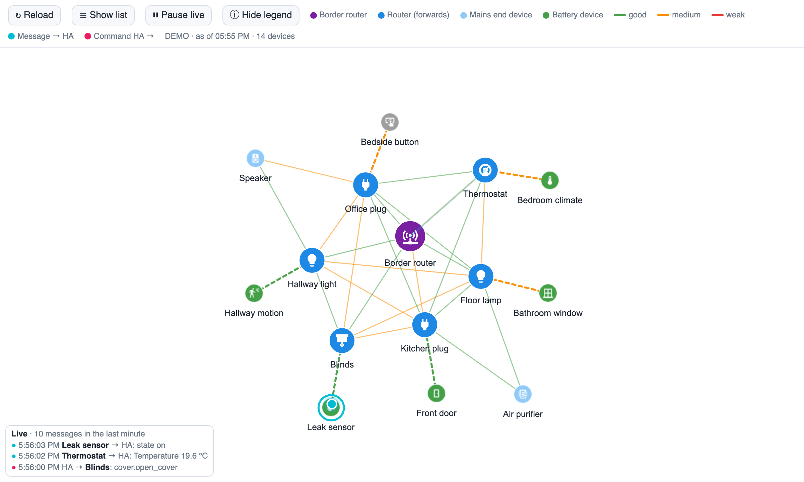

# Thread Pulse

**A live map of your Thread network for Home Assistant – watch your Matter devices talk.**



Thread Pulse draws the mesh of your Matter-over-Thread devices (routers, battery devices, border router, signal strength) and animates every message as it happens:

- **cyan dot** – a device reports something to Home Assistant (a sensor value, a button press, a light that was switched)
- **magenta dot** – Home Assistant sends a command to a device

Each dot travels the path the message most likely takes through the mesh: device → its parent router → … → border router. A small ticker shows the latest messages and how many arrived in the last minute.

It is a single HTML page that runs in your browser inside a Home Assistant dashboard. No integration, no add-on, no server component, no external requests.

## Features

- Interactive mesh map (drag, zoom), icons chosen from what each device does (light, plug, window, motion, button, thermostat …)
- Link colours by signal strength (RSSI): green ≥ −65 dBm, orange ≥ −80 dBm, red below
- Battery devices are linked to their parent router (dashed); their signal is taken from the router's measurement, which is more reliable than the device's own
- Live animation of messages to and from Home Assistant, with a ticker
- Optional table: battery devices and their parents, weakest first, plus weak router-to-router links
- Follows the Home Assistant theme (light/dark); English and German (from your Home Assistant language)
- Does **not** wake up battery devices: it only reads data Home Assistant already has

## Requirements

- Home Assistant with the **Matter** integration and Matter devices on **Thread**
- An **administrator** user (the page reads device diagnostics and the entity registry, which Home Assistant only allows for admins)
- Recommended: the **OpenThread Border Router** add-on. With other border routers (Apple, Google, Amazon …) the map still works; the live paths only work if Thread Pulse can tell which router is the border router (see limitations)

## Installation

1. Download `thread-pulse.html` and `thread-pulse-vis-network.min.js` from this repository.
2. Copy both files into the `www` folder of your Home Assistant configuration (`/config/www/`, for example with the *File editor* or *Samba share* add-on). Create the folder if it does not exist – if you have to create it, restart Home Assistant once.
3. Add a card to a dashboard. Easiest is a full-page view (*panel* view) with an iframe card:

   ```yaml
   views:
     - title: Thread
       path: thread
       type: panel
       cards:
         - type: iframe
           url: /local/thread-pulse.html?v=1
           aspect_ratio: 100%
   ```

   Or, in the UI: *Edit dashboard → Add view → View type “Panel (single card)”*, then add a *Webpage* card with the URL `/local/thread-pulse.html?v=1`.

After updating the files, raise the number in `?v=1` so browsers and the companion app load the new version.

**Try it without Home Assistant:** open `thread-pulse.html?demo` in a browser (invented devices, simulated traffic). `&lang=de` switches to German.

## How it works

| What | Where it comes from |
|---|---|
| Devices, roles, neighbours, signal | Thread Network Diagnostics cluster of each Matter node, from Home Assistant's cached Matter diagnostics |
| Routes | Route tables of the routers (same source) |
| Border router | `otbr/info` of the OpenThread Border Router integration |
| Live messages | Home Assistant `state_changed` and `call_service` events of the Matter devices' entities |

## Limitations – please read

- **The animation shows messages to and from Home Assistant, not radio packets.** Thread's own background traffic (routers exchanging status every ~30 s, battery devices polling their parent, retransmissions) is not visible. Seeing real radio traffic needs a second 802.15.4 radio as a sniffer plus Wireshark and the network key.
- **The path is the most likely route, not a measured one.** It is computed from the route tables at the time the page was loaded. Thread can change routes at any time. Press *Reload* to refresh the map.
- **Only Matter devices.** Thread devices paired via HomeKit or other ecosystems only appear as “other Thread router” if they route, and their traffic is not shown.
- **Several border routers / no OpenThread add-on:** if Thread Pulse cannot identify the border router, the map still works, but messages are not animated. With several border routers (e.g. HA plus an Apple TV), messages may actually leave the mesh through another border router than the one shown.
- **Relies on Home Assistant's diagnostics format**, which is not an official API. A future Home Assistant or Matter server update may break it.
- **Admins only** (see requirements).
- Tested with Home Assistant 2026.10, one OpenThread Border Router (SONOFF Dongle Plus MG24) and about 20 Matter-over-Thread devices. Other setups are untested.

## Privacy

Everything runs in your browser. The page uses the session of the logged-in Home Assistant user to read data from your own Home Assistant and sends nothing anywhere else. No external scripts or fonts are loaded.

## Related projects

Thread Pulse focuses on the live view of messages. For a detailed, static analysis of your Matter and Thread network, have a look at:

- The network map of the Home Assistant **Matter Server**
- [Matter Navigator](https://github.com/teh-hippo/ha-matter-navigator)

## Support

This is a hobby project, provided as is. Issues with a description of your setup (border router, number and type of devices, Home Assistant version) are welcome, but there is no guarantee of a fix.

## License

MIT – see [LICENSE](LICENSE). Third-party components: see [NOTICE](NOTICE).

---

### Kurz auf Deutsch

Thread Pulse zeigt das Thread-Netz deiner Matter-Geräte als Karte und animiert live jede Meldung an Home Assistant (cyan) und jeden Befehl von Home Assistant (magenta) entlang des wahrscheinlichsten Funkwegs. Installation: beide Dateien nach `/config/www/` kopieren und eine Webseiten-Karte mit `/local/thread-pulse.html?v=1` anlegen (am besten in einer Panel-Ansicht). Die Sprache folgt der Home-Assistant-Einstellung. Einschränkungen siehe oben – insbesondere: angezeigt werden Nachrichten von und zu Home Assistant, keine Funkpakete, und der Weg ist berechnet, nicht gemessen.
