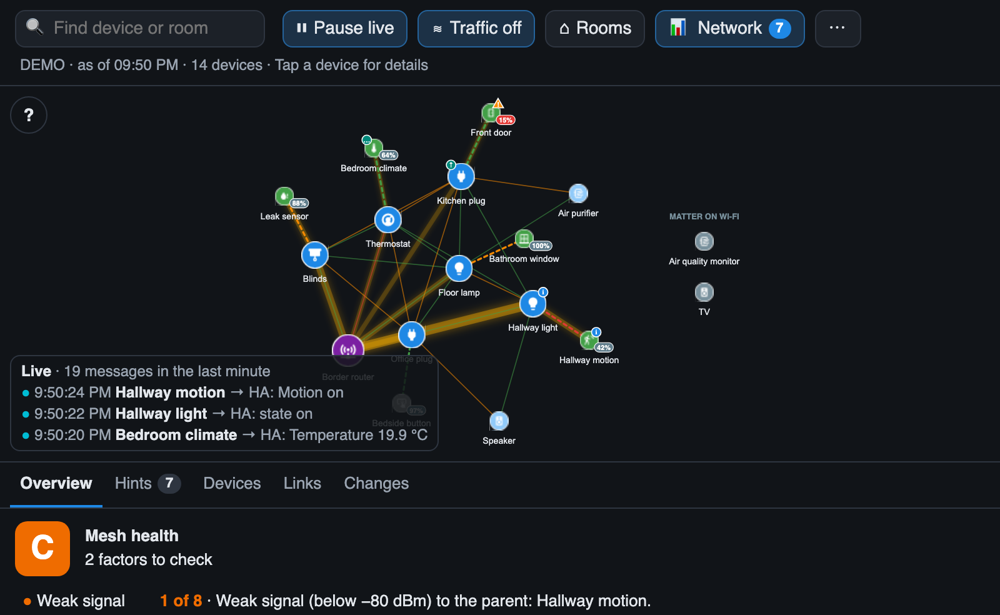

# Change log

Thread Pulse notices when something changes in your Thread network and lists it with a time stamp.

> The change log only works while a Thread Pulse page is open. For a message on your phone when a device goes offline, use the [offline notification blueprint](Offline-Notification).

## What is detected

| Change | Colour | How it is detected |
|---|---|---|
| Device **not reachable** / **reachable again** | red / green | **Live**, as soon as Home Assistant marks the device's main entities as unavailable or available again |
| Device **new in the network** / **no longer in the network** | green / red | at the next check |
| **New parent** of a battery or end device, e.g. *new parent: Hallway light → Blinds (−58 dBm)* | purple | at the next check |
| **Signal to the parent** changes quality (good / medium / weak) | orange | at the next check |
| **Role** changes, e.g. router → end device | purple | at the next check |
| A usable **link between two routers** appears or is lost | orange | at the next check; only links of −80 dBm or better are watched, to avoid noise |
| The **[mesh health](Mesh-Health) grade** changes, e.g. *Mesh health B → C* *(from version 1.6.0)* | green (better) / red (worse) | when two checks in a row agree |

The affected device **flashes** three times on the map.

## When it is checked

- **Every 5 minutes** while a Thread Pulse page is open. The data is loaded again and compared with the previous state. The map keeps its positions and zoom; only devices whose data changed move.
- When you click **↻ Reload** (in the **⋯** menu from version 1.6.0) or tap the status line.
- Reachability changes are logged **immediately**.

## The list

The tab **Changes** of the [network panel](The-List) *(from version 1.6.0; before: the section at the top of the list)* shows how many entries are new since you last looked, and the latest 30 entries: time, coloured dot, device (a link to its [detail panel](Detail-Panel)) and the change. **Clear list** empties it – on all your devices.

## Where the list is stored

*From version 1.6.0; up to 1.5.2 every browser had its own list.*

- The list is stored **in Home Assistant, per user** (up to 200 entries; the [signal trend](Detail-Panel#trends) is stored the same way) – the same list on your phone, tablet and computer. Other Home Assistant users have their own list.
- Open pages **synchronise live**: a change seen on the wall tablet appears in the list on the phone right away.
- When several pages are open, each of them notices the same change; it is **kept once** (same device, same change, within 10 minutes). A device that goes offline, online and offline again still shows all three entries.
- The first time a page connects, the entries that were stored in this browser by older versions are **moved to Home Assistant** and removed from the browser.
- If Home Assistant refuses to store the list (very old versions), it is kept in the browser as before.

## Limitations

- Parent, role and link changes only appear once the devices **report** them to Home Assistant, which can take a while.
- Changes that happen while **no** Thread Pulse page is open are not seen (except that the next comparison shows the new state).
- In [demo mode](Demo-Mode) an invented change happens every 40 seconds; the demo list is not stored.
