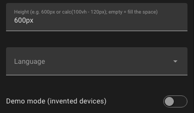

# Configuration

## Card options

All options are optional. They can be set in the visual card editor or in YAML.



| Option | Default | Description |
|---|---|---|
| `height` | fills the available space, at least 450 px | Any CSS height, e.g. `600px`, `70vh` or `calc(100vh - 120px)` |
| `language` | language of your Home Assistant profile | `en` (English), `de` (German); from version 1.4.0 also `fr` (French), `it` (Italian), `es` (Spanish), `nl` (Dutch) |
| `show_wifi` | `true` | Show Matter devices on Wi-Fi / Ethernet as a separate group *(from version 1.4.0)* |
| `ambient` | `false` | [Ambient mode](Ambient-Mode) for wall tablets: only the mesh, dark *(from version 1.4.0)* |
| `ambient_motion` | `true` | In ambient mode: slow automatic zoom on or off *(from version 1.4.0)* |
| `demo` | `false` | Show invented devices and simulated traffic instead of your network |

### Minimal card

```yaml
type: custom:thread-pulse-card
```

### Full-screen view (panel view)

A panel view shows a single card over the whole width. Set the height so that the map fills the screen below the header:

```yaml
views:
  - title: Thread
    path: thread
    type: panel
    cards:
      - type: custom:thread-pulse-card
        height: calc(100vh - var(--header-height, 56px))
```

### In a sections view

In a *sections* view the card behaves like other cards and can be resized in the dashboard editor. By default it takes the full width and 10 rows (minimum 6 columns × 6 rows). Leave `height` empty there, so the card fills the space you give it.

### Fixed height in a masonry view

```yaml
type: custom:thread-pulse-card
height: 650px
language: de
```

## Standalone page options

The standalone page (installation option C) is configured with URL parameters:

| Parameter | Example | Description |
|---|---|---|
| `demo` | `/local/thread-pulse.html?demo` | Demo mode with invented devices |
| `lang` | `/local/thread-pulse.html?lang=de` | Force the language (`en`, `de`, `fr`, `it`, `es`, `nl` – the last four from version 1.4.0) |
| `ambient` | `/local/thread-pulse.html?ambient` | [Ambient mode](Ambient-Mode) *(from version 1.4.0)* |
| `still` | `/local/thread-pulse.html?ambient&still` | Ambient mode without the automatic zoom *(from version 1.4.0)* |
| `nowifi` | `/local/thread-pulse.html?nowifi` | Hide Matter devices on Wi-Fi / Ethernet *(from version 1.4.0)* |
| `v` | `/local/thread-pulse.html?v=3` | No function – raise it after an update so browsers load the new version |

Parameters can be combined: `/local/thread-pulse.html?v=3&lang=en`.

## Settings remembered by the browser

Some choices are remembered per browser (and per Home Assistant address), not per card:

| Setting | Where |
|---|---|
| Network panel below the map shown or hidden, its tab | 📊 Network (up to version 1.5.2: ☰ Show list) |
| Legend shown or hidden | **?** on the map (up to version 1.5.2: ⓘ Legend in the toolbar) |
| Traffic heat on or off | ≋ Traffic |
| Room view on or off | ⌂ Rooms |
| Sound on or off, volume | **⋯** → 🔇 Sound (up to version 1.5.2: in the toolbar) |
| Change log entries | – |

The legend starts hidden *(after version 1.5.2; before, it started shown on screens wider than 700 px)*. Whether a device was opened once is also remembered: until then the status line shows *Tap a device for details*.

## Language

Thread Pulse follows the language of your Home Assistant user profile. Supported are **English** and **German**, and from version 1.4.0 also **French**, **Italian**, **Spanish** and **Dutch**; other languages fall back to English. Entity names come from Home Assistant; common English measurement names (e.g. *Active current*, *Voltage*) are translated in the live ticker and the detail panel.

The French, Italian, Spanish and Dutch texts have not been checked by native speakers yet. Corrections are welcome – every language has its own file in [`src/i18n/`](https://github.com/riticulus/ha-thread-pulse/tree/main/src/i18n) (e.g. `fr.js`).

## Theme

The card uses the colours of your Home Assistant theme, including dark mode. Switching between light and dark is picked up automatically.
