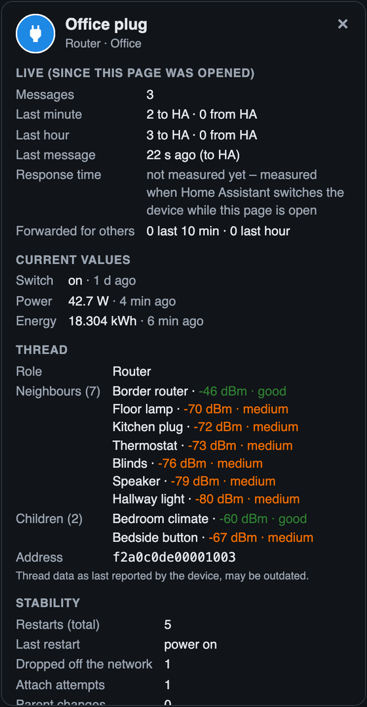

# Detail panel

Tap or click a device on the map to open its detail panel. It takes the place of the [network panel](The-List) in the column next to the map; on narrow screens (e.g. a phone) that column is below the map *(from version 1.7.0; before, the panel opened over the map)*.

**Close it** with **‹ Network** above the name, by tapping empty space on the map, or with the **Esc** key – the network panel comes back. You can also open it from the [network panel](The-List) (device names are links) and with **Enter** in the [search](Search).

## Layout *(from version 1.7.0)*

At the top: the name, the [warnings](Hints-and-Warnings) and a row of **key numbers** – signal in dBm (to the parent, for routers the best link to another router), messages in the last hour, battery level (or restarts for devices without a battery) and, for routers, the number of children. Below them the sections are grouped in three **tabs**; the tab you chose stays selected when you open another device:

| Tab | Sections |
|---|---|
| **Status** | Hints, current values, battery, stability |
| **Connection** | Live counters, Thread, trends, *If this router fails* |
| **Device** | Device data, connected systems, identify, open in Home Assistant |

The border router, other Thread routers and Wi-Fi / Ethernet devices keep one list without tabs.

The panel updates itself every 5 seconds while it is open.

## Header

Icon, name, role in the Thread network and Home Assistant area. *NOT REACHABLE* is added when Home Assistant reports the device as unavailable.

## Diagnosis *(from version 1.7.0)*

For a device that is **not reachable**, dropped out in the last days, or has warnings, the tab *Status* starts with a **Diagnosis**: the likely causes found in the data, each marked **Likely** or **Possible** and with what to do next. Checked in this order: drop-outs in the [change log](Change-Log), signal to the parent, the parent being unreachable or losing power, the device losing power itself, unstable connection, battery level and [forecast](#battery), [radio channel](Radio-Channels) overlap, and whether the device is in another Thread network than the others. If nothing fits, it says so and suggests checking the device itself. It is a rule of thumb from the reported data, not a measurement. The [text report](Text-Report) lists the diagnosis of unreachable devices too.

## Warnings and hints

Orange boxes (**⚠**) are warnings, blue boxes (**💡**) are hints. See [Hints and warnings](Hints-and-Warnings).

## Live (since this page was opened)

| Row | Meaning |
|---|---|
| Messages | Messages to and from Home Assistant since the page was opened |
| Last minute / Last hour | Split into *to HA* and *from HA* |
| Last message | How long ago, and in which direction |
| Response time | Last value, median and number of measurements – see [Response time](Response-Time) |
| Forwarded for others | Routers only: messages passed on for other devices (last 10 min / last hour) |

These counters start at zero when the page is opened.

## Current values

The device's main entities from Home Assistant (no diagnostic or configuration entities, nothing hidden or disabled) with their state and when they last changed, e.g. *Power 42.7 W · 4 min ago*.

## Battery

Battery level (from the battery entity in Home Assistant) and battery type as reported by the device (e.g. *AAA*, *CR2450*).

**Forecast** *(from version 1.4.0)*: an estimate of when the battery will be empty, e.g. *empty in about 10 months · based on 46 days, −3.7 % per month*.

- Calculated from Home Assistant's **long-term statistics** (daily average of the battery level, kept permanently) over up to 120 days, as a straight-line trend.
- After a **battery change** (the level jumps up), only the values since the change are used.
- *Not enough data yet* – fewer than 14 days of statistics (e.g. a newly added device).
- *No measurable drop* – the level has hardly changed (common for new batteries and coin cells).
- It is an **estimate**: many batteries stay almost full for a long time and then drop quickly, and some devices report the level in coarse steps.

**Trend** *(from version 1.6.0)*: a small chart of the battery level over the **last 7 days** – the hourly average from Home Assistant's statistics, so it is complete even for times when no Thread Pulse page was open. The dashed line marks 20 %. See [trends](#trends).

## Thread

| Row | Meaning |
|---|---|
| Role | Router, Router (leader), End device, End device (can become router), Sleepy end device |
| Parent | Battery and end devices: the router they talk through, with signal strength |
| Neighbours | Routers: all neighbours with signal strength, strongest first |
| Children | Routers: battery devices that use this router as parent |
| Address | Extended Thread address of the device |

These values are what the device last reported to Home Assistant and may be outdated.

## If this router fails

*From version 1.6.0.* In the panel of every router (not the border router) – an **estimate** of what would happen if this router went offline:

- **Devices that use it as parent**, each with what it could do:
  - *can switch to Kitchen plug (−62 dBm)* – a mains device that already has another router in reach (from its own neighbour table, −85 dBm or better)
  - *battery device – other routers in reach are not reported* – battery devices only report their parent, so it is unknown whether another router can reach them
  - *no other router in reach known*
- **Cut off from the border router:** routers that only reach the border router through this router, and the devices that use them. Calculated from the links between routers; needs a known border router (OpenThread Border Router add-on).
- *Nothing depends on it alone* when every device and router has another path.

**Show affected devices on the map** marks them (like the [search](Search)); *Show all* on the map ends it.

It is based on the last reported neighbour tables. Thread repairs itself: devices look for a new parent, possibly one that is not in their current table – so it says what is **at risk**, not what will certainly happen. The [network panel](The-List) lists all routers by how many devices depend on them (tab *Links*).

## Trends

*From version 1.6.0.* Below the Thread section, a small chart shows the signal over the **last 7 days**:

- **Battery and end devices:** the signal to their parent (*Signal to the parent · 7 days*)
- **Routers:** the best link to another router (*Best link to a router · 7 days*)

Below each chart the latest value is shown. **Hover over the chart or tap it** to see the value of that hour, e.g. *Mon, 08:00 · −62 dBm · good*. The thin vertical lines mark midnight; the dashed line marks −80 dBm (weak).

**Where the signal history comes from:** Home Assistant does not keep the Thread signal, so Thread Pulse records it itself – at every load and every automatic check (every 5 minutes) **while a page is open**, averaged per hour. **Gaps** in the line are hours in which no page was open; the note below the chart says how many of the 168 hours are covered. The history starts when you install this version.

The history is stored **in Home Assistant, per user** (frontend user data, about 30–40 KB for 20 devices), written at most every 15 minutes – so a wall tablet that is always open fills the history for your phone too. If Home Assistant refuses to store it, it is kept in the browser. Older than 7 days is removed.

The battery chart is in the [battery section](#battery).

## Stability

| Row | Meaning |
|---|---|
| Restarts (total) | All restarts over the device's lifetime – including every power cut (a bulb on a wall switch restarts each time it is switched on) |
| Last restart | Reason of the last restart: power on, brown-out, software/hardware watchdog, firmware update, software reset |
| Dropped off the network | How often the device lost the Thread network since its last restart |
| Attach attempts | How often it tried to (re)join since its last restart |
| Parent changes | How often it changed its parent since its last restart |

## Device

Manufacturer, model, firmware version, hardware version and area.

**Update** *(from version 1.6.0)*: the firmware update state that Home Assistant knows for the device – *up to date*, *1.4.0 available*, *1.4.0 available – skipped* (skipped in Home Assistant) or *installing 1.4.0 · 40 %*. Updates are installed in Home Assistant, not in Thread Pulse.

## Connected systems

*From version 1.6.0.* A Matter device can be controlled by several systems at the same time (Matter *fabrics*): Home Assistant, Apple Home, Google Home, Amazon Alexa … This section shows how many systems the device is connected to and which ones, e.g. *Apple Keychain* and *Home Assistant (Open Home Foundation) · this Home Assistant*.

- *Apple Keychain* is the connection an iPhone keeps after it was used to add a Matter device – also if the device was then shared with Home Assistant only.
- The number is known right away; the list of systems is loaded when the panel is opened (Home Assistant may ask the device, which takes a moment – battery devices can take longer).
- Connections are removed on the device page in Home Assistant, not in Thread Pulse.

## Border router and other Thread routers

*Available from version 1.4.0.*

Tap the **border router** to see the Thread network and the border router itself:

| Section | Content |
|---|---|
| Live · Messages through it | Every animated message passes the border router: total, last minute, last hour, last message |
| Thread network | Network name, channel, PAN ID, extended PAN ID, routers in the mesh (*n of max. 32* – Thread allows at most 32 routers), Thread devices, leader router |
| Mesh health | The [mesh health](Mesh-Health) grade with its factors *(from version 1.6.0)* |
| Radio channels | Thread, Zigbee and Wi-Fi channels and their overlaps – see [Radio channels](Radio-Channels) *(from version 1.7.0)* |
| Border router | Type (*OpenThread Border Router (add-on)*); manufacturer, model, name and Thread version as announced on the network *(from version 1.5.0)*; Thread address, border agent ID, the Thread networks known to Home Assistant (the preferred one is marked) |
| Thread | Neighbours and children (battery devices using the border router as parent) with signal strength |

The values come from the OpenThread Border Router integration; without it, Thread Pulse uses what the Matter devices report. The **network key is never shown**.

**Border routers of other systems** *(from version 1.5.0)*: Home Assistant looks for border routers on your local network (Apple TV, HomePod, Google Nest, Amazon Echo …). When one of them is also on the map, it is shown with the name it announces – for Apple devices the name from the Home app, e.g. *HomePod Salon · Border router …7114* (Apple announces the same model *BorderRouter* for all devices, so the model is only used when it says more) – and a border router icon in grey. The names arrive a few seconds after the map is drawn; the map, the list and the hints are updated then *(names and list from version 1.5.1)*. Its panel shows manufacturer, model, name (as set in its own app), Thread version and network, and – if Home Assistant uses another border router – that Home Assistant does not use it for its messages. Border routers on the network that are not part of the mesh are not shown; routers that are not border routers stay *other Thread router*.

**Other Thread routers** (grey, not Matter devices of Home Assistant) show their neighbours and children and a note that Home Assistant has no further data about them. When the border router is unknown, the parent router of a device also counts the messages of its children and explains that only this first hop is animated *(from version 1.5.0)*.

## Matter devices on Wi-Fi / Ethernet

*Available from version 1.4.0.*

Devices in the grey-blue column on the right use Wi-Fi or Ethernet instead of Thread. Their panel shows the live counter and response time, current values, restarts and device data, and for Wi-Fi devices a **Wi-Fi** section:

| Row | Meaning |
|---|---|
| Signal | Wi-Fi signal strength as last reported by the device; good −60 dBm or better, medium down to −70 dBm, weak below |
| Channel | Wi-Fi channel |
| Standard | Wi-Fi standard, e.g. 802.11n |

## Identify

*Available from version 1.5.0.*

**💡 Identify** makes the device show itself for a few seconds – a lamp blinks, a plug flashes its LED, some sensors beep. Useful when several devices have similar names or you are not sure which one is which on the map.

- The button is only shown when Home Assistant has an *identify* button for the device (Matter devices that support the Identify function; Thread and Wi-Fi). Not every device supports it; it disappears while the device is unreachable.
- **It sends a real command to the device.** That is why the button says so and is locked for a few seconds after pressing it.
- **Battery devices** only react when they wake up, which can take a while.
- The command appears on the map like every other command (magenta dot, *button.press* in the live ticker). It is not counted as a response time, because Home Assistant does not get a confirmation for it.

## Open device in Home Assistant

The button at the bottom opens the device page in Home Assistant (*Settings → Devices*).
