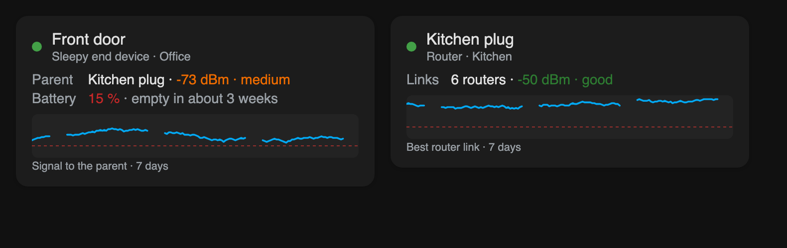

# Device card

*From version 1.7.0.*

A small card for **one Thread device** – for a room dashboard, without the whole map. It comes with Thread Pulse (same file, nothing extra to install).



## What it shows

| Line | Content |
|---|---|
| Header | Name, role in the Thread network and area; a green dot when the device is reachable, red with *not reachable* when Home Assistant reports it unavailable |
| **Parent** | Battery and end devices: the router they talk through, with its signal (green / orange / red as on the map). The value measured by the router is used when the router reports it, as on the map |
| **Links** | Routers: how many other routers they reach, and the best signal |
| **Battery** | Level and, once there are 14 days of statistics and a measurable drop, the [battery forecast](Detail-Panel#battery) |
| Chart | Signal of the last 7 days – to the parent, for routers the best router link. It is the [trend](Detail-Panel#trends) that Thread Pulse records while its map is open somewhere; hours without an open map are gaps |

Wi-Fi and Ethernet devices only get their name and a note – they are not part of the Thread mesh.

**Tap the card** to open the Thread Pulse map with this device selected and zoomed to (option `map_path`), or – without `map_path` – the device page of Home Assistant.

## Adding it

In the dashboard editor: **+ Add card** → *Thread Pulse – device* → choose the device. It takes the full width of a section and grows with its content; make it narrower in the editor if you like. Or in YAML:

```yaml
type: custom:thread-pulse-device-card
device: 01d78d2a0af558eb4decc71b82676fee   # device ID – an entity ID of the device works too
name: Schalter Küche                       # optional
map_path: /dashboard-network/thread        # optional: the view with the Thread Pulse map
```

| Option | Description |
|---|---|
| `device` | **Required.** The device (device ID), or one of its entities (`sensor.front_door_battery`) |
| `name` | Name shown on the card; empty = the device name in Home Assistant |
| `map_path` | Path of the dashboard view with the Thread Pulse card. Tapping the device card opens it with `?tp_device=<device ID>`, and the map selects that device. Empty: tapping opens the device page |
| `language` | Like the main card; empty = Home Assistant language |
| `demo` | `true` (battery device) or `router` – invented data, e.g. to try the look |

## Good to know

- Like the map, the card needs an **administrator** account (it reads the Matter diagnostics).
- To name the parent it reads the cached diagnostics of all Matter devices – once for all device cards on a page, at most every 5 minutes. No device is queried, battery devices are not woken up.
- The chart only has data where the Thread Pulse map was open (for example on a wall tablet). Without that, the card says so.
