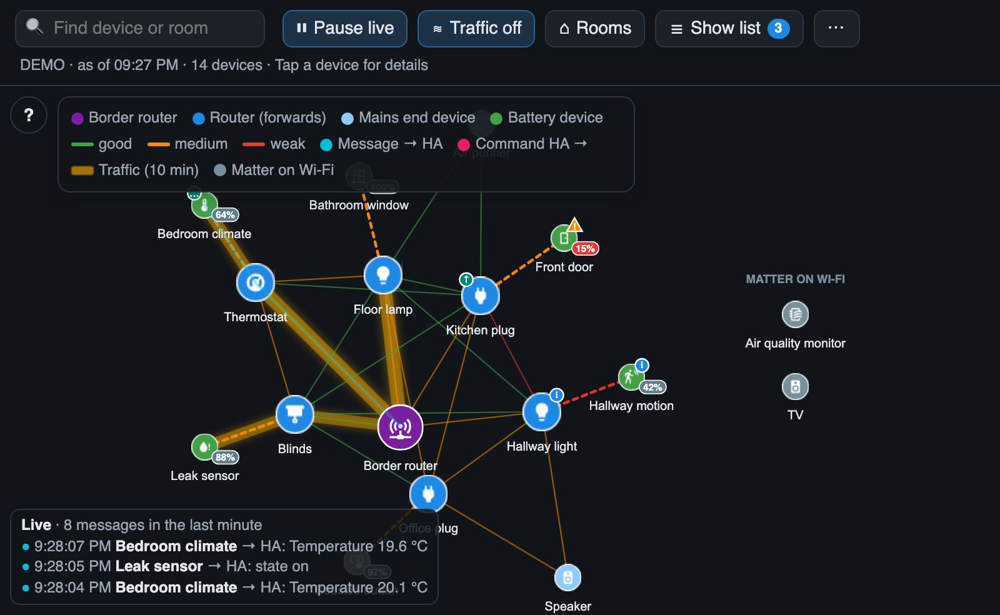

# Thread Pulse – User Guide

**Thread Pulse** is a live map of your Thread network for Home Assistant. It shows how your Matter-over-Thread devices are connected, how good their radio links are, and – as it happens – every message travelling between your devices and Home Assistant.

*All screenshots in this guide come from the built-in demo mode with invented devices.*

## What you can do with it

| | |
|---|---|
| **See the mesh** | Routers, battery devices, the border router and the signal strength of every link |
| **Watch it live** | A dot travels along the route for every message to and from Home Assistant |
| **Find the busy routes** | Links glow brighter the more traffic they carried in the last 10 minutes |
| **Inspect a device** | Tap it for firmware, parent, neighbours, battery, stability counters, response time … – and the border router for the Thread network itself *(from version 1.4.0)* |
| **Find weak spots** | Hints for weak parent signals, unstable connections and routers that lose power; a [mesh health](Mesh-Health) grade with its reasons *(from version 1.6.0)* |
| **Notice changes** | A change log of new parents, devices dropping out and coming back |
| **Think in rooms** | Arrange the devices by Home Assistant area |
| **Hear it** | Optional quiet tick for every message *(from version 1.4.0)* |
| **Share it** | Save the map as an image, optionally anonymised – for documentation or a forum post *(from version 1.5.0)*. Or copy a [text report](Text-Report) as Markdown *(from version 1.6.0)* |
| **Hang it on the wall** | Ambient mode: only the pulsing mesh, dark, for wall tablets *(from version 1.4.0)* |

## Where to start

1. **[Installation](Installation)** – HACS, manual card or standalone page
2. **[Configuration](Configuration)** – card options and dashboard examples
3. **[Reading the map](Reading-the-Map)** – what the colours, lines and badges mean

Then explore the features:

- [Live data flow and traffic heat](Live-Data-Flow)
- [Detail panel](Detail-Panel)
- [Hints and warnings](Hints-and-Warnings)
- [Response time](Response-Time)
- [Radio channels](Radio-Channels)
- [Change log](Change-Log)
- [Room view](Room-View)
- [Search](Search)
- [Network panel](The-List)
- [Ambient mode](Ambient-Mode)
- [Demo mode](Demo-Mode)

Background and help:

- [How it works](How-It-Works) – data sources, route calculation, privacy
- [Troubleshooting & FAQ](Troubleshooting-and-FAQ)
- [Limitations](Limitations)
- [Development](Development)

## Requirements in short

- Home Assistant with the **Matter** integration and Matter devices on **Thread**
- A user with **administrator** rights
- Recommended: the **OpenThread Border Router** add-on

This guide describes **{{VERSION}}**. The [changelog](https://github.com/riticulus/ha-thread-pulse/blob/main/CHANGELOG.md) lists what changed in each version.

> This wiki is generated from the folder [`docs/wiki`](https://github.com/riticulus/ha-thread-pulse/tree/main/docs/wiki) of the repository and updated with every release. Changes made directly in the wiki are overwritten – please suggest corrections with a pull request or an [issue](https://github.com/riticulus/ha-thread-pulse/issues).
