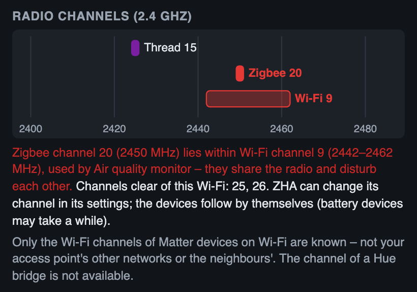

# Radio channels

*After version 1.6.0.*

Thread, Zigbee and 2.4 GHz Wi-Fi share the same radio band. When a Thread or Zigbee channel lies inside a Wi-Fi channel, they compete for airtime – devices then lose messages, reconnect more often or drop off. Thread Pulse shows the channels it knows on one frequency axis and warns about overlaps.

## Where

- Tab **Links** of the [network panel](The-List), at the top
- Panel of the [border router](Detail-Panel#border-router-and-other-thread-routers)
- Each overlap is also a hint in the tab **Hints** (labelled *Radio channels*) and in the [text report](Text-Report); the text report also lists the other channels (*Other radio channels: Zigbee 20 · Wi-Fi 9*)

## What is known

| Network | Source | Width |
|---|---|---|
| **Thread** | OpenThread Border Router, else the preferred Thread network, else what the devices report | 2 MHz, channel *n* at 2405 + 5 × (*n* − 11) MHz |
| **Zigbee** | ZHA (`zha/network/settings`) – only the channel is read, never the network key | 2 MHz, same numbering as Thread |
| **Wi-Fi** | The Wi-Fi channel each Matter device on Wi-Fi reports (5 GHz channels are ignored) | about 20 MHz around 2407 + 5 × *k* MHz |

**Not known:** the other channels of your access point, the neighbours' networks, Zigbee2MQTT, and the channel of a Hue bridge. Without a Matter device on 2.4 GHz Wi-Fi no Wi-Fi channel is known at all; the note under the diagram says so.

## Overlaps and suggestions

A Thread or Zigbee channel counts as **inside** a Wi-Fi channel when its centre is less than 11 MHz from the Wi-Fi centre. The diagram marks both in red, and the text says what to do:

- **Zigbee inside Wi-Fi:** the Zigbee channels that are clear of the known Wi-Fi – preferably also of the common Wi-Fi channels 1, 6 and 11 (usually 15, 20, 25, 26). ZHA can change its channel in its settings; the devices follow by themselves, battery devices may take a while.
- **Thread inside Wi-Fi:** changing the Thread channel is disruptive – every Thread device has to follow, and not every border router can do it. Thread Pulse therefore suggests moving the Wi-Fi to channel 1, 6 or 11, whichever is clear of Thread and Zigbee.
- **Thread and Zigbee on the same channel:** they share its airtime.

These are hints, not measurements: Thread Pulse does not see the actual radio traffic, only which channels are configured.
