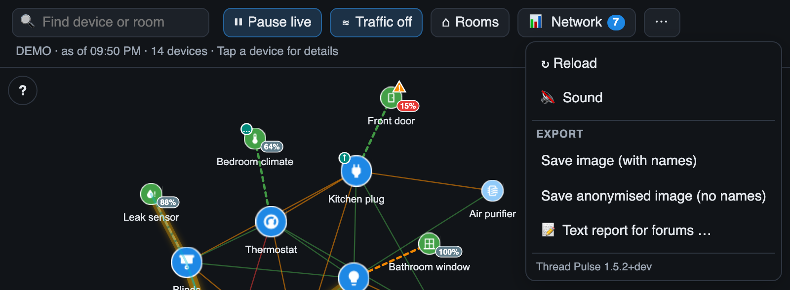
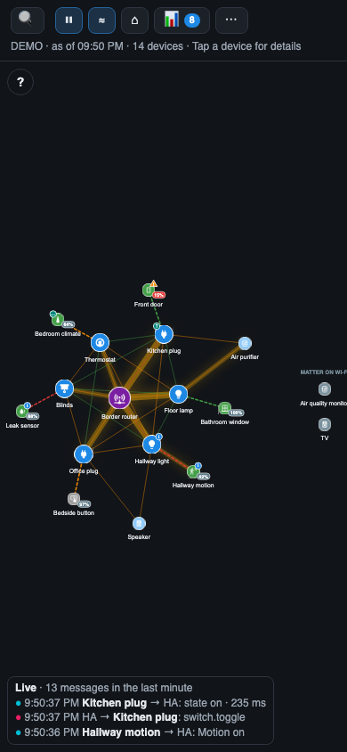

# Reading the map

## Toolbar

*After version 1.5.2* the toolbar is one row: the search, the view switches, the network panel and a **⋯** menu for everything else. Up to version 1.5.2 all buttons and the legend were in the toolbar.

| Element | Function |
|---|---|
| **🔍 Find device or room** | [Search](Search) |
| **⏸ Pause live / ▶ Resume live** | Stop or restart the [live animation](Live-Data-Flow). Counting continues while paused |
| **≋ Traffic / Traffic off** | Switch the [traffic heat](Live-Data-Flow#traffic-heat) on or off |
| **⌂ Rooms / Rooms off** | Switch the [room view](Room-View) on or off |
| **📊 Network** | Show the [network panel below the map](The-List) with its tabs (overview, hints, devices, links, changes). The blue number is the number of [warnings and hints](Hints-and-Warnings) |
| **⋯** | Menu: **↻ Reload** (load the network data again and redraw the map, also compares with the previous state for the [change log](Change-Log)), **🔇 Sound** with its volume slider (see [sound](Live-Data-Flow#sound)), **Export**: [save the map as an image](Saving-an-Image) with names or anonymised, or copy a [text report](Text-Report), and the installed version |
| Status line | Time of the last update and number of devices; *Tap a device for details* until you have opened a device once. **Tap the status line to reload** |
| **?** (top left on the map) | Show or hide the colour legend |

Buttons that switch something on (live, traffic, rooms, network panel) are **highlighted while it is on**. Tooltips show what a button does.

## Devices (nodes)

Every Matter device on Thread is a round icon. The **icon** shows what the device does (light, plug, window, door, motion, button, thermostat, blinds, lock, fan, valve, leak, smoke, air quality, temperature, speaker …). It is chosen from the device's entities in Home Assistant, not from its name. Devices without a known function get a chip icon.

The **colour** shows the role in the Thread network:

| Colour | Role | Meaning |
|---|---|---|
| Purple, with antenna icon | **Border router** | Connects the Thread network to Home Assistant (e.g. the OpenThread Border Router add-on with a USB stick) |
| Dark blue, large | **Router** | Mains-powered device that forwards messages for others |
| Light blue | **End device on mains** | Mains-powered device that does not forward right now (it can become a router if needed) |
| Green, small | **Battery device** | Sleepy end device; it talks only through its *parent* router |
| Grey | **Not reachable** | Home Assistant currently reports the device as unavailable |
| Grey-blue, in a column on the right *(from version 1.4.0)* | **Matter on Wi-Fi / Ethernet** | A Matter device that is not on Thread. Not part of the mesh, so it has no links; its messages are counted but not animated |
| Grey with router icon | **Other Thread router** | A Thread router that is not a Matter device of Home Assistant, e.g. an Apple TV, a HomePod or a Google Nest device |
| Grey with antenna icon, name | **Border router of another system** | A border router found on your local network, e.g. *HomePod Salon · Border router …7114* *(from version 1.5.0)* |

Hover a device (desktop) to see its name and role; tap or click it to open the [detail panel](Detail-Panel). From version 1.4.0 this also works for the border router and other Thread routers.

## Links (lines)

| Line | Meaning |
|---|---|
| **Solid line** | Radio link between two routers (or a mains device and a router) |
| **Dashed line** | A battery device and its **parent** – the router it talks through |
| **Green** | Good signal: −65 dBm or better |
| **Orange** | Medium signal: −66 to −80 dBm |
| **Red** | Weak signal: below −80 dBm |

The value is the received signal strength (RSSI). For router-to-router links both directions are averaged. For battery devices the value measured **by the parent router** is used, because sleepy devices report their own measurement unreliably; if only the device's own measurement exists, it is marked *uncertain* in the list.

Hover a line (desktop) to see its signal strength and – with traffic heat on – how many messages it carried in the last 10 minutes.

## Badges on devices

| Badge | Meaning |
|---|---|
| **87%** (grey) | Battery level of a battery device |
| **35%** (orange) | Battery below 40 % |
| **15%** (red) | Battery below 20 % |
| **⚠** (orange triangle) | Warning: unstable connection or battery below 20 % – see [Hints and warnings](Hints-and-Warnings) |
| **i** (blue circle) | Hint: a possible weak spot – see [Hints and warnings](Hints-and-Warnings) |
| **↑** (green circle, top left) | A firmware update is available in Home Assistant (not shown for skipped updates) *(after version 1.5.2)* |
| **…** (green circle, top left) | A firmware update is being installed *(after version 1.5.2)* |

## Moving around

- **Zoom:** mouse wheel or pinch
- **Move the map:** drag the background
- **Move a device:** drag it (the layout adjusts)
- **Back to the full view:** double-click (or double-tap) on empty space – the whole mesh is centered and fitted to the screen *(from version 1.4.0; in older versions use ↻ Reload)*
- **Zoom to a device:** double-click (or double-tap) it – it is centered in the part of the map that the detail panel does not cover *(from version 1.4.0)*

## Live ticker

The box in the bottom left shows how many messages arrived in the last minute and the three latest messages. See [Live data flow](Live-Data-Flow).

## On a phone

On narrow screens (a card narrower than 640 px, e.g. a phone) the toolbar buttons show **icons only** – the highlighted ones are on – and the search is a 🔍 icon that widens when you tap it. The [detail panel](Detail-Panel) slides up from the bottom.
