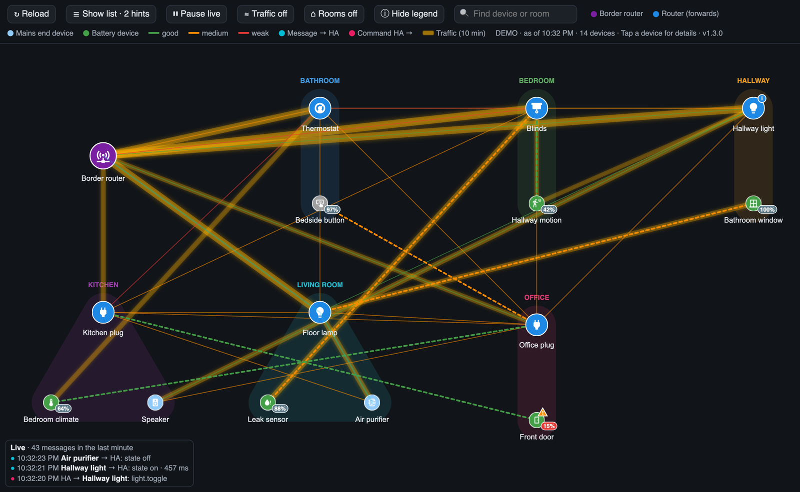

# Room view

**⌂ Rooms** arranges the devices by their **Home Assistant area**.

- Every area gets its own spot on a grid, shown as a coloured region with the room name.
- The devices of a room sit in a ring around that spot, routers first.
- The **border router** and devices **without an area** share the first spot (top left).
- All links stay visible, so you can see at a glance which links **cross rooms** – for example window sensors in the living room that use a plug in another room as their parent.

The grid follows the shape of the map area: more columns on a wide screen, fewer on a phone in portrait.

## Switching back

**⌂ Rooms off** returns to the normal layout: the devices glide back to where they were before the room view was switched on, and the map is fitted to the screen. If the room view was already on when the page was loaded, the normal layout is calculated first and then fitted.

The choice is remembered by the browser.

## Tips

- Assign an area to every Thread device in Home Assistant (*Settings → Devices*) to get a useful room view.
- The room view uses the area of the **device**, not of individual entities.
- While the room view is on, the automatic layout (physics) is paused. You can still drag devices by hand.
- Double-click on empty space fits all rooms to the screen *(from version 1.4.0)*.

## Limitations

- On a phone the room view is cramped; the lowest room can be partly covered by the live ticker.
- Long device names in the same ring can touch.
