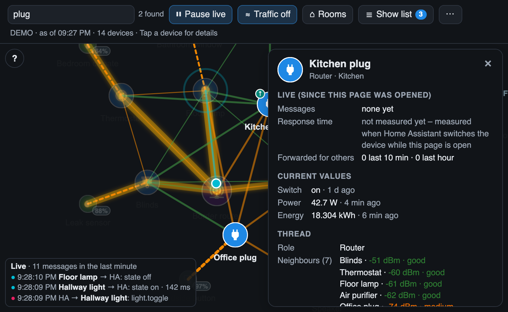

# Search

The search field **🔍 Find device or room** in the toolbar finds devices by **name** or **area**.

- Case and accents are ignored: `kuche` finds *Küche*, `PLUG` finds *Kitchen plug*.
- Matching devices stay bright and are selected; all others fade out, including their badges.
- The map zooms to the matches (one match: it focuses and zooms in on that device).
- The number of matches is shown next to the field, e.g. *2 found* or *no match*.

## Keys

| Key | Action |
|---|---|
| **Enter** | Open the [detail panel](Detail-Panel) of the first match |
| **Esc** | Clear the search and show the whole network again |

On a phone the search field is a 🔍 icon that widens when you tap it *(from version 1.6.0)*.

The search stays active after **↻ Reload** and after the automatic checks of the [change log](Change-Log).

## Examples

| Search | Finds |
|---|---|
| `window` | all devices with "window" in the name |
| `Kitchen` | all devices in the area *Kitchen* and all devices with "kitchen" in the name |
| `sensor` | all sensors whose name contains "sensor" |
